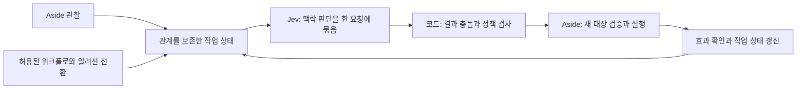

[English](0001-composable-jev-decisions.md) | [한국어](0001-composable-jev-decisions.ko.md)

# RFC 0001: 작업 맥락을 보존하는 Jev 워크플로 평가

상태: **구조 변경 제안. 이 RFC는 실행 동작을 변경하지 않습니다.**
분석 기준: `969d7b5b93971f6e96fc855fc23731d19a38b2a4`.
근거: [GitHub 사용 사례](../research/jev-github-cases.ko.md),
[커밋이 고정된 출처 목록](../research/jev-github-sources.json).

## 변경 요청

**작업과 그 관계를 Jev 판단의 단위로 삼습니다.** 목표와 관련된 워크플로 상태를
일관되고 제한된 크기로 전달하고, 작업 전환에 필요한 맥락 판단을 한 요청에서
받습니다. 애플리케이션은 그 결과를 사용해 이미 정의된 작업을 실행하거나 멈춥니다.

DOM 요소별 점수나 사실마다 별도 요청하는 방식으로 작업 이해를 대체하지 않습니다.
같은 레이블도 소속 영역·주변 필드·제약·이전 행동의 결과·사용자 목표에 따라 의미가
달라집니다. 요소가 같아도 관계가 바뀌면 다음 단계가 달라질 수 있습니다.
이 맥락을 보존하는 것이 핵심이며 출력 타입만 늘리는 것으로 해결되지 않습니다.

## 현재 브라우저 경로의 문제

[현재 코드 비교](../research/jev-github-cases.ko.md#현재-코드와-차이)에서 확인한
경로는 행동 Choice만 요청하는 `choose_live`, 관련 줄 중심의 관찰 압축,
실행 후 완료·위험 평가로 구성됩니다. 줄 단위 압축은 비슷한 레이블을 구별하거나
워크플로를 이해하는 데 필요한 맥락을 생략할 수 있습니다. `system_one`은 이미
Choice·Noul·Score를 지원하므로 상태 모델과 통합 구조의 문제입니다.

제한된 행동 선택도 유효한 Jev 사용입니다. 요청의 취지는 작업 상태와 워크플로
제어를 함께 활용하도록 확장하는 것입니다.
별도 [Rust 성능 PR](https://github.com/himomohi/aside-jev/pull/2)은 로컬 처리와
전송 비용을 다루며 이 의미 구조 문제를 해결하지 않습니다. 이 RFC는 main을
기준으로 독립 작성했습니다.

## 제안 구조

관찰 어댑터는 실제 근거를, 상태 생성기는 식별자·범위·관계·관찰 범위를 담당합니다.
질문 정의는 필요한 워크플로 판단을 표현하고 제공자는 타입별 응답과 분포를
보존합니다. 조합 코드는 모순과 정책을 검사하고 기존 실행기는 권한·신선도·효과를
검증합니다. 나중에 Rust로 구현하더라도 이 의미상의 경계는 유지합니다.

### 작업 상태 계약

`TaskState`에 다음을 담습니다.

- 사용자 목표·제약·현재 단계·완료에 필요한 근거.
- 실제 관찰 사실·관찰 식별자·URL·애플리케이션 식별자.
- 관련 영역·대화상자·필드·대상 사이 관계와 정확한 대상 식별자.
- 이전 허용 행동·관찰된 효과·남은 선행 조건·모순.
- 코드가 정의한 제안 전환·허용 연산·선행 조건·기대 효과.
- 관찰 범위·생략된 영역·누락된 필수 근거. 누락과 실제 부재를 구분합니다.

관련 영역과 의존 관계를 함께 보존합니다. 입력 필드를 남기면서 소속 대화상자나
선행 조건 메시지를 버린 상태는 완전한 작업 상태가 아닙니다. 전체 DOM을 무제한
전송하지 않고 크기를 제한합니다. 필수 맥락이 들어가지 않으면 멈추거나 허용된
범위에서 필요한 영역을 다시 관찰합니다. 생략을 부재로 해석하지 않습니다.
일반 정제 과정도 관계를 없앨 수 있으므로 정제·직렬화된 실제 전송 상태를
검사해야 합니다. 현재 Jev 입력은 텍스트/JSON이며 스크린샷 직접 입력이 아닙니다.

### 의미 판단이 필요한 시점마다 한 요청

호출 시점은 작업 관련 근거·단계·가능한 전환이 바뀌어 맥락 판단이 필요한 때입니다.
DOM 요소마다 또는 단순 로컬 검사마다 호출하지 않습니다. 작은 질문 묶음이
현재 작업 상태 전체를 함께 사용하도록 합니다.

| 출력 | 타입 | 공유된 작업 상태에서 판단할 내용 |
| :--- | :--- | :--- |
| `route` | Choice | 알려진 제안 전환 실행, 재관찰, 사용자 입력 요청, 완료, 판단 보류 중 선택. |
| `task_satisfied` | Noul | 현재 근거가 사용자 목표와 관련 제약을 충족하는지 판단. |
| `evidence_sufficient` | Noul | 현재 관련 상태가 이 작업 전환을 판단하기에 충분한지 판단. |
| `transition_risk` | Score | 상태에 명시된 제안 전환의 결과를 순서가 있는 기준으로 평가. |
| `state_conflict` | Noul | 현재 근거에 작업에 영향을 주는 모순이 있는지 판단. |

화면의 요소 수와 관계없이 하나의 공유 맥락 요청입니다. 워크플로에 필요한 출력만
사용합니다. 대상 유일성·ON/OFF·URL 일치 같은 확정적 검사는 코드에서 처리합니다.

같은 Jev 요청의 질문은 다른 질문의 답을 볼 수 없습니다. 따라서 `transition_risk`는
아직 모르는 `route` 결과가 아니라 상태에 이미 적힌 전환을 평가합니다. 독립 출력의
모순은 조합 코드가 검사해야 하며 한 요청에 묶었다고 결과의 일관성이 보장되지는
않습니다. 앞선 판단 이후 새 근거나 새 전환 후보를 얻었다면 후속 요청이 필요합니다.
변하지 않은 작업을 요소별 반복 요청으로 나누지 않습니다.

[요청 예시](0001-workflow-request.json)는 기존 `system_one` 인자 구조와 가상
근거·질문 5개를 사용합니다. 새 공개 도구나 실행 권한을 추가하지 않습니다.
제안 상태 스키마의 예시이며 실제 모델로 평가한 결과는 아닙니다.

### 워크플로와 실행 정책

코드 또는 이미 권한이 있는 호출자가 제한된 워크플로와 전환 목록을 제공합니다.
Jev는 선택자·입력값·실행 코드·권한을 새로 만들지 않습니다. 초기 실행 전환은
현재 지원되는 연산 하나를 포함합니다. 여러 연산을 묶는 작업은 별도 명시 계약과
연산별 검증이 필요하며, 이 RFC가 현재의 실시간 판단 요구를 우회하지 않습니다.

조합 코드는 전체 응답을 검증한 뒤 실행합니다. 완료 경로를 골랐어도 목표 근거가
충족되지 않으면 완료로 확인하지 않습니다. 불충분하거나 모순된 근거로 실행을
허용하지 않습니다. 모델의 위험 판단은 권한을 부여하지 않습니다. 대체 임계값을
검증하고 합의할 때까지 기존 confidence 기준을 유지합니다. 효과 발생 직전에
정책과 유일한 최신 대상을 확인하고 실행 후 실제 효과를 검증합니다.

새 사후 근거가 필요한 최종 평가는 유지합니다. 아직 존재하지 않은 근거를 실행
이전 요청에 넣을 수 없습니다. 기존 완료 문구/URL 검사·오류 시 중단·단계/시간
예산·ON/OFF·오래된 관찰 검사·수동 재개를 유지합니다. 조용한 재시도·대체 모델·
캐시된 판단 재실행·행동 권한 확대를 추가하지 않습니다.

### 제한과 기준 검증

현재 로컬 제한인 질문 최대 32개, 직렬화된 질문 64,000자, 정제된 상태 24,000자와
기존 실행 예산을 지킵니다. 이는 Aside Jev의 제한이며 모든 Jev 통합에 대한 주장이
아닙니다. 관찰·평가 기준 식별자와 원래 분포를 제한된 저장 공간에서 보존합니다.
같은 근거의 정책 분석에는 재사용할 수 있으나 새 효과에는 새 근거와 판단이 필요합니다.

Choice confidence·Noul 참의 확률·Score 위치/신뢰도는 의미가 다릅니다. 판단 종류·
결과의 영향·모델·평가 기준 버전별로 임계값을 검증합니다. 다른 저장소의 값을
복사하거나 확률 하나를 정답 보증으로 취급하지 않습니다. 검증 중 기존 기준을
호환성의 기준선으로 유지합니다.

## 적용 단계와 검증 조건

1. RFC를 검토하고 작업 상태·전환 계약에 합의합니다.
2. 관계가 있는 오프라인 상태 사례와 완전한 직렬화 검증을 만듭니다.
3. 기존 동작을 유지하며 명시적으로 선택하는 새 워크플로 모드를 구현합니다.
4. 같은 작업에서 두 모드를 비교하고 권한이 있는 실제 환경에서만 평가합니다.
5. 품질·지연·되돌리기 조건을 합의한 후 기본 동작 전환을 결정합니다.

| 검증 상황 | 충족할 조건 |
| :--- | :--- |
| 다른 영역의 같은 레이블과 서로 영향을 주는 선행 조건 | 식별자와 관계를 보존하고 그 맥락에서 작업을 판단합니다. |
| 완료 문구는 보이나 관련 선행 조건은 미충족 | 문구만으로 완료를 확인하지 않습니다. |
| 필수 맥락 생략 또는 정제 중 손실 | 근거 누락을 표시하고 완전한 상태로 가장해 실행하지 않습니다. |
| 실행 대상이 없는 종료 상태 | 행동 후보를 만들어내지 않고 목표를 판단합니다. |
| 같은 상태에 대한 맥락 출력 5개 | 제공자 요청 1회이며 요소별 요청 루프가 없습니다. |
| 모순·잘못된 형식·일부 누락 응답 | 정책에 따라 중단하거나 근거를 요청하며 무권한 효과가 없습니다. |
| 새 근거 또는 새 제안 전환 | 상태를 다시 만들며 이전 분포를 새 권한으로 사용하지 않습니다. |
| OFF·오래된 대상·중복 대상·시간 초과·예산 소진 | 기존 검증이 실행을 차단합니다. |

작업 성공과 잘못된 완료/실행을 우선 측정하고 관계 보존·누락 처리·출력 충돌을
확인합니다. 이후 판단 시점당 호출 수·토큰/비용·p50/p95 지연을 관찰·상태 생성·
제공자·실행·검증으로 나눠 측정합니다. 이 문서 PR은 브라우저 속도나 정확도 향상을
주장하지 않습니다. GitHub 사례는 구현 패턴의 근거이며 운영 성능 검증이 아닙니다.
실행 구조 구현과 실제 비교 결과는 후속 작업입니다.
