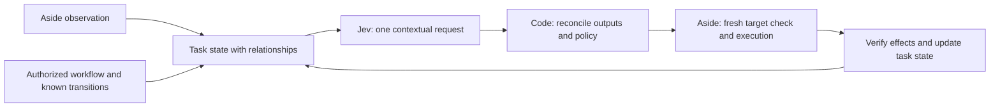

[English](0001-composable-jev-decisions.md) | [한국어](0001-composable-jev-decisions.ko.md)

# RFC 0001: Context-preserving Jev workflow evaluation

Status: **Proposed; no runtime behavior changed by this RFC.**
Analysis baseline: `969d7b5b93971f6e96fc855fc23731d19a38b2a4`.
Evidence: [GitHub cases](../research/jev-github-cases.md) and
[commit-pinned source manifest](../research/jev-github-sources.json).

## Requested change

Make the task and its relationships the unit of Jev evaluation. Give Jev a coherent,
bounded representation of the relevant workflow state and ask for the contextual
judgments needed at a workflow transition in one request. The application then
uses those outputs to execute or stop the known workflow.

Do not replace task understanding with individual DOM-element scores or one API
request per fact. A label's meaning depends on its section, surrounding fields,
constraints, prior effects, and the user's goal. The same elements can imply a
different next step when their relationships change. Preserving that context is
the main architectural change; adding more output types alone will not achieve it.

## Problem in the current browser path

The [source comparison](../research/jev-github-cases.md#what-the-current-repository-actually-does)
shows an action-only `choose_live` request, line-ranked observation compaction,
and a completion/risk assessment after browser execution. Line compaction can
omit context required to distinguish similar labels or understand a workflow.
The existing `system_one` API already supports Choice, Noul, and Score, so this is
an integration and state-model problem, rather than a missing primitive.

Bounded action selection is a valid Jev use case. The request is to use it with
richer task state and workflow control, not to claim it is inherently invalid.
The separate [Rust performance PR](https://github.com/himomohi/aside-jev/pull/2)
addresses local processing and transport overhead; it does not resolve this
semantic architecture problem. This RFC is independently based on main.

## Proposed boundaries

The observation adapter owns observed evidence. The state builder preserves its
identity, scope, relationships, and coverage. A question catalog describes the
needed workflow judgments. A provider retains typed answers and distributions.
The arbiter applies policy and reconciles conflicting answers. The existing
executor checks authorization, freshness, and effects. Rust can implement these
boundaries later without changing their meaning.

### Task state contract

A `TaskState` packet should contain:

- The user's goal, constraints, workflow phase, and required completion evidence.
- Current observed facts, observation identity, URL, and application identity.
- Relevant section/dialog/field/target relationships and exact target identities.
- Previous authorized actions, observed effects, outstanding prerequisites, and contradictions.
- A code-defined proposed transition, its allowed operation, prerequisites, and expected effect.
- Coverage, omitted scopes, and missing mandatory evidence, distinguished from observed absence.

Select relevant scopes together with their dependencies. For example, retaining
an input while dropping its dialog identity or a prerequisite message is not a
complete packet. Bound the packet; do not send unlimited raw DOM. If mandatory
context cannot fit, stop or obtain an authorized targeted observation. Do not
silently interpret truncation as absence. An implementation must inspect the
serialized, sanitized packet as well as its input, since generic sanitization can
remove relationships. Jev currently consumes text/JSON, not screenshots directly.

### One request per semantic checkpoint

A checkpoint is a change in task-relevant evidence, workflow phase, or available
transition requiring contextual judgment. It is not every DOM element or routine
local check. A small bundle can cover the entire current task state:

| Output | Type | Meaning over the shared task state |
| :--- | :--- | :--- |
| `route` | Choice | Execute the known proposed transition, observe again, request input, finish, or abstain. |
| `task_satisfied` | Noul | Whether the current evidence satisfies the user's goal and related constraints. |
| `evidence_sufficient` | Noul | Whether the relevant state supports deciding this workflow transition. |
| `transition_risk` | Score | Consequences of the explicitly described proposed transition, under an ordered rubric. |
| `state_conflict` | Noul | Whether the current evidence contains a material contradiction affecting this workflow. |

This is one shared-context request, regardless of how many UI elements appear.
Use only outputs needed by the workflow. Exact target uniqueness, ON/OFF, URL
matching, and other deterministic checks remain local code operations.

Questions in one Jev request cannot read each other's answers. Consequently,
`transition_risk` refers to a transition already present in the state, not the
unknown answer to `route`. The arbiter must reconcile independent outputs;
batching does not guarantee a mutually consistent joint decision. A later request
is justified when earlier results lead to new evidence or new transition options.
Do not split an unchanged task into repeated per-element requests.

The [illustrative request](0001-workflow-request.json) uses the existing
`system_one` argument shape, fictional evidence, and five questions. It introduces
no new public tool and grants no execution permission. Its proposed state schema
is illustrative; it has not been evaluated with a live model.

### Workflow and execution policy

Code or an already-authorized caller supplies the bounded workflow and transition
registry. Jev does not invent selectors, values, executable code, or authorization.
Initially, each executable transition contains one currently supported operation.
Multi-operation recipes need a separate explicit contract and per-operation
checks; this RFC does not bypass the current live-decision requirement.

The arbiter validates the full response before acting. A finish route with unmet
goal evidence cannot produce verified completion. Insufficient or conflicting
evidence cannot authorize execution. Model risk assessment cannot grant permission.
Retain the existing confidence gates until replacement thresholds have been
calibrated and accepted. Recheck policy and the unique fresh target immediately
before an effect, then verify the actual effect.

Final assessment over new post-action evidence remains necessary where required;
it cannot be folded into a request made before that evidence existed. Retain the
current local completion text/URL checks, stop-on-error behavior, step/deadline
budgets, ON/OFF rules, stale-observation checks, and manual resumption. No silent
retry, fallback model, replay of cached decisions, or expanded action permissions.

### Bounds and calibration

Honor the current local limits: at most 32 questions, 64,000 serialized question
characters, and 24,000 sanitized state characters, plus existing operation budgets.
These are Aside Jev's limits, not claims about every Jev integration. Preserve raw
distributions with observation and rubric identity for review, within bounded
storage. Reuse them only for policy analysis over the same evidence; fresh effects
require fresh evidence and decisions.

Choice confidence, Noul truth probability, and Score position/confidence have
different meanings. Validate thresholds per judgment, task consequence, model,
and rubric version. Do not import other repositories' thresholds or treat any
single probability as guaranteed correctness. The current gates remain the
compatibility baseline during evaluation.

## Migration and acceptance

1. Review this RFC and agree on the task-state and transition contracts.
2. Build offline relational-state fixtures and validate complete serialization.
3. Implement an explicit opt-in workflow mode with unchanged legacy behavior.
4. Compare both modes on the same tasks, using authorized live evaluation only.
5. Adopt a default only after quality, latency, and rollback criteria are accepted.

Required evaluation scenarios include:

| Scenario | Acceptance requirement |
| :--- | :--- |
| Same labels in different sections, with interacting prerequisites | Preserve identities and relationships; evaluate the task in that context. |
| Completion label visible but related prerequisite unmet | Never report verified completion solely from the label. |
| Required context omitted or lost during sanitization | Report missing evidence; do not execute from an apparently complete packet. |
| Terminal state with no executable target | Goal assessment still works without manufacturing an action candidate. |
| Five contextual outputs over one state | One provider request; no UI-element request loop. |
| Inconsistent, malformed, or incomplete answers | Stop or request evidence according to policy, with no unauthorized effect. |
| New evidence or new proposed transition | Rebuild state; never treat prior distributions as a fresh authorization. |
| OFF, stale target, ambiguous target, timeout, or exhausted budget | Existing guards still prevent execution. |

Measure end-to-end goal success and false completion/execution first, together
with relationship retention, missing-evidence handling, and conflicting outputs.
Then measure provider calls per checkpoint, tokens/cost, and p50/p95 latency split
into observation, state construction, provider, execution, and verification.
No browser-speed or accuracy improvement is claimed by this documentation PR.
The GitHub cases demonstrate implementable patterns, not verified production
performance. Runtime implementation and live comparative results remain follow-up work.
